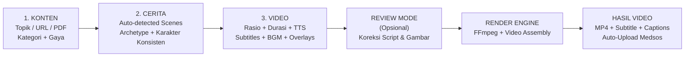
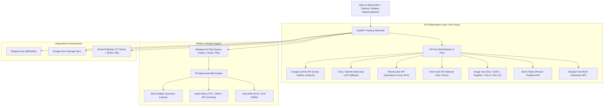
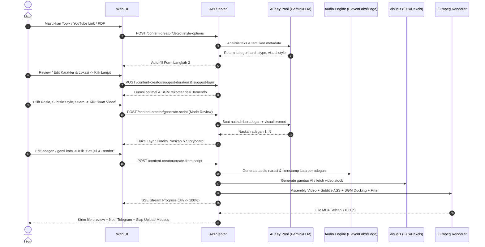

# 🎬 BLUEPRINT 1:1 & ROADMAP KLIPERS AI CONTENT CREATOR (ENTERPRISE EDITION)

> **Dokumentasi Hasil Penjelajahan Langsung (Live CamoFox Inspection)**  
> **Target Analisis:** `https://klipers.pro/ai-content-creator` dan seluruh ekosistem dashboard Klipers Pro  
> **Status Akun Pengujian:** Enterprise (411 Credits)  
> **Tujuan:** Membangun platform 1:1 (dan upgrade) dengan memanfaatkan kumpulan API Key AI pribadi (Gemini multi-key rotation, ElevenLabs, Fish Audio, Groq/OpenAI, Flux/SDXL/Midjourney, Jamendo, Pexels/Pixabay, Telegram Bot, dll.) tanpa batasan kredit dan tanpa biaya langganan.

---

## 📑 DAFTAR ISI
1. [Hasil Eksplorasi & Audit Fitur Live](#1-hasil-eksplorasi--audit-fitur-live)
2. [Arsitektur Sistem & Pemanfaatan API Key AI](#2-arsitektur-sistem--pemanfaatan-api-key-ai)
3. [Userflow Lengkap (Step-by-Step UI/UX)](#3-userflow-lengkap-step-by-step-uiux)
4. [Daftar 24 Endpoint Inti AI Content Creator](#4-daftar-24-endpoint-inti-ai-content-creator)
5. [Spesifikasi Teknis Engine & Modul Pendukung](#5-spesifikasi-teknis-engine--modul-pendukung)
6. [To-Do List & Roadmap Eksekusi Bertahap](#6-to-do-list--roadmap-eksekusi-bertahap)
7. [Checklist Kebutuhan Lengkap (Zero-Missed)](#7-checklist-kebutuhan-lengkap-zero-missed)

---

## 1. Hasil Eksplorasi & Audit Fitur Live

Setelah login menggunakan akun Enterprise via CamoFox browser, kami menjelajahi dan membedah seluruh komponen front-end, state machine, modal, dan dokumentasi API backend resmi (`https://api.klipers.pro/api` v3.6).

### A. Fitur Inti AI Content Creator (`/ai-content-creator`)
Berbeda dengan sekadar *clipping video panjang*, **AI Content Creator** adalah generator video faceless otomatis end-to-end yang mengubah **Topik / Link YouTube / Artikel PDF** menjadi video utuh berdurasi 30 detik – 3 menit dalam 3 langkah interaktif:



#### Langkah 1: Konten (Input Source)
- **Sumber Input:**
  1. `Topik`: Tulis prompt bebas (misal: "Misteri Segitiga Bermuda yang Belum Terpecahkan").
  2. `YouTube`: Paste URL video YouTube (AI otomatis fetch transkrip via YouTube transcript scraper).
  3. `Artikel / PDF`: Input link website berita (Detik, Kompas, dll.) atau upload file dokumen PDF/teks.
- **21 Kategori Konten:**
  `Storytelling Umum`, `Misteri & Horror`, `Gaya Komik`, `Berita & Info`, `Anak-anak`, `Opini & Debat`, `Roasting`, `Sejarah Nabi`, `Kisah Sahabat`, `Sejarah`, `Biografi`, `Sains & Tekno`, `Mental Health`, `Mitos vs Fakta`, `Keuangan Pribadi`, `Fakta Unik`, `Kesehatan`, `Luar Angkasa`, `Cerita Rakyat`, `True Crime`, `Review Film`.
- **10 Gaya Pembawaan:**
  `Storytelling`, `Tutorial`, `Motivasi`, `Fakta Viral`, `Berita`, `Misteri`, `Anak-anak`, `Opini`, `Roasting`, `Komik`.
- **Fokus Cerita:**
  `Otomatis`, `Fokus Topik`, `Fokus Tokoh`.

#### Langkah 2: Cerita (Story & Character Consistency Engine)
AI otomatis menginferensi dan mengisi 7 field karakter & latar:
- **Gaya Visual (8 Pilihan):** `Auto-detect`, `Foto-Real`, `Found Footage`, `VHS 80s`, `2D Gelap`, `3D Render`, `Anime`, `Storybook`.
- **Lokasi AI (12 Pilihan):** `Auto-detect`, `Rumah Kosong`, `Hutan / Belantara`, `Rumah Sakit`, `Sekolah`, `Kost / Apartemen`, `Jalanan / Gang`, `Kampung Pedalaman`, `Bawah Air / Waduk`, `Gua`, `Pemakaman`, `AI Pilih Sendiri`.
- **Archetype Cerita (9 Pilihan):** `Auto-detect`, `Urban Legend (Kuntilanak/Pocong/dll)`, `True Crime`, `Supernatural Klasik`, `Cosmic / Lovecraftian`, `Psikologis / Paranoid`, `Ritual / Okultisme`, `Benda Berhantu`, `Tempat Angker`.
- **Intensitas (6 Pilihan):** `Auto-detect`, `Slow Burn (atmosferik)`, `Jump-Scare Heavy`, `Mind-bend / Psikologis`, `Body Horror`, `Pseudo-Documentary`.
- **Daerah / Budaya Lokal:** Input nama daerah (contoh: *Banyuwangi, Jogja, Suku Dayak*) — AI menyisipkan diksi lokal, mitos daerah, dan referensi budaya khas.
- **Konsistensi Karakter Protagonis:** Input nama, deskripsi visual, dan upload foto wajah referensi (maks 20MB) agar wajah tokoh konsisten di setiap adegan (*character sheet consistency*).
- **Sosok / Antagonis Signature:** Deskripsi detail visual sosok yang konsisten muncul di tiap adegan.

#### Langkah 3: Pengaturan Video & Audio
- **Rasio:** `9:16` (TikTok/Reels/Shorts) & `16:9` (YouTube Panjang).
- **Durasi & Scene:** Slider 30s – 3m (dilengkapi tombol AI: *Saran durasi & jumlah scene optimal*).
- **Transisi Video:** `None (—)`, `Fade`, `Slide`, `Smooth`, `Mix`.
- **Overlays Sinematik (15 Gaya):** `Off`, `Vignette`, `Dark Tint`, `Cinematic`, `Film Grain`, `Light Leak`, `Film Burn`, `Chromatic`, `Dreamy Glow`, `Percikan Tinta (tiap ganti scene)`, `Petir Hitam`, `Partikel Hitam`, `Debu Hitam`, `Tinta + Petir`, `Tinta + Partikel`. Slider intensitas (0-100%).
- **Musik Latar (BGM):**
  - Jamendo Royalty-Free API integration dengan rekomendasi mood otomatis oleh AI.
  - Opsi: *Off*, *Auto*, *Upload MP3*, *Library Search*.
  - Pengatur volume (default 15%).
- **Multi-TTS Engine & Suara:**
  - `Klipers TTS` (Free Edge-TTS): 7 suara Indonesia (William, Andrew, Brian, Ardi, Ava, Emma, Gadis) + 4 Multilingual.
  - `Fish Audio API`: 14 suara Indonesia berkarakter tinggi dengan tag emosi.
  - `ElevenLabs API`: 37+ suara curated Indonesia (Aita, Bram, Citra, Denas, Dera, Dhani, Fajar, Kang Nandar, dll.).
  - `Custom Cloned Voice`: Suara hasil clone milik user sendiri.
- **Auto Subtitle & Styling (38 Presets):**
  - Font: *Montserrat, Orbitron, Teko, Archivo Black, Fredoka One, Anton, Bebas Neue, Creepster, Quicksand, Rubik Glitch, Roboto, Lato, Poppins, Oswald*.
  - Format: UPPERCASE / Title Case / lowercase.
  - Colors: Text color, Highlight color, Outline stroke, Background box.
  - Smart Emoji: Otomatis memunculkan emoji animasi sesuai kata kunci (*semangat → 🔥*, *keren → 😎*).
  - Terjemahan subtitle otomatis (Bilingual ID / EN / MY).
- **Opsi Render & Human-In-The-Loop:**
  - `Campur AI + Video Stock` (Pexels / Pixabay) vs `Gambar AI Saja`.
  - Checkbox `Review Script & Gambar`: Jeda proses agar user bisa membaca narasi per adegan, menata ulang prompt gambar, atau mengedit teks sebelum render video dimulai.
- **Template Presets:** Menyimpan seluruh konfigurasi menjadi preset favorit untuk pembuatan 1-klik berikutnya.

---

### B. Fitur-Fitur Pelengkap di Dashboard Klipers
1. **Story Studio (`/story-studio`):** Studio naskah multi-babak (Ide → Naskah per adegan → Storyboard gambar + suara pemeran → Video Editor).
2. **Motion Studio (`/motion-studio`):** 14 preset animasi kinetic, infografis data (*Bedah 3D, Proses 3D, Jurnalisme Visual Vox-style, Kolase Kartun, Finansial, Geografi 3D Globe, Angka Hidup*).
3. **AI Workflow Node Graph (`flow.klipers.pro`):** Visual canvas mirip ComfyUI / Dify dengan node: *Prompt, LoRA, ControlNet, Image Model, Video Chain, Concat Video*.
4. **Voice Clone (`/voice-clone`):** Upload rekaman 1-2 menit, instant zero-shot voice cloning yang otomatis tersedia di seluruh modul.
5. **Brand Kit (`/brand-kit`):** Watermark logo transparan, safe-zone viewer untuk layout tombol TikTok/Reels agar tidak tertutup UI.
6. **Viral Analytics (`/viral-analytics`):** Pelacak YouTube trending Indonesia real-time, skor viral, estimasi RPM/pendapatan, waktu posting terbaik.
7. **Social Auto-Upload (`/integrations`):** Kalender penjadwalan & auto-publish ke TikTok, YouTube Shorts, Facebook Reels.
8. **Settings & Custom API Key (`/profile`):** Slot konfigurasi API Key user sendiri (Gemini dengan koma untuk rotasi otomatis, ElevenLabs, Fish Audio, YouTube Data API, Telegram Bot).

---

## 2. Arsitektur Sistem & Pemanfaatan API Key AI

Untuk membangun klon 1:1 tanpa server berbayar mahal dan memanfaatkan timbunan API Key Anda secara maksimal, berikut arsitektur modular yang dirancang:



### Strategi Pemanfaatan API Key:
1. **Google Gemini (Rotasi Multi-Key):**
   - Format: `AIzaSyA...,AIzaSyB...,AIzaSyC...`
   - Digunakan untuk: Analisis topik, generate naskah multi-scene, inferensi karakter/lokasi/archetype, viral hook score, translate subtitle, dan rekomendasi BGM.
   - Rotasi otomatis menangani limit RPM/TPM tingkat gratis (Free Tier) tanpa pernah kena error 429.
2. **ElevenLabs:**
   - Digunakan untuk narasi suara premium dan `Auto SFX` (efek suara per adegan, misal: petir, pintu berderit, ledakan).
3. **Fish Audio:**
   - Alternatif suara emosional Indonesia yang sangat natural dan hemat.
4. **Edge-TTS (Local Python):**
   - Suara gratis unlimited (William, Andrew, Ardi, Gadis, dll.) tanpa memerlukan API key.
5. **Jamendo API (Free Developer Key):**
   - Akses jutaan lagu royalty-free dengan query dinamis berbasis genre & mood video.
6. **Pexels & Pixabay API (Free Key):**
   - Pengambilan stock footage video untuk mode *Campur AI + Video Stock*.
7. **Telegram Bot API:**
   - Mengirim notifikasi dan file MP4 preview langsung ke HP Anda saat video selesai diproses.

---

## 3. Userflow Lengkap (Step-by-Step UI/UX)



---

## 4. Daftar 24 Endpoint Inti AI Content Creator

Berdasarkan API v3.6 resmi Klipers, berikut daftar 24 endpoint yang wajib diimplementasikan untuk paritas 1:1:

| No | Method | Endpoint Path | Fungsi & Logika Bisnis |
|---|---|---|---|
| 1 | `POST` | `/content-creator/create` | Pembuatan video langsung dari topik/URL/PDF secara otomatis |
| 2 | `POST` | `/content-creator/generate-script` | Pembuatan naskah adegan saja (tanpa render, untuk preview) |
| 3 | `POST` | `/content-creator/create-from-script` | Render video dari naskah yang sudah dikonfirmasi user |
| 4 | `GET` | `/content-creator/status/:jobId` | Polling status pengerjaan video |
| 5 | `GET` | `/content-creator/stream/:jobId` | Realtime Server-Sent Events (SSE) progress update (0-100%) |
| 6 | `POST` | `/content-creator/refine-script` | Memperbaiki / menulis ulang naskah dengan instruksi teks bebas |
| 7 | `POST` | `/content-creator/insert-scene` | Menyisipkan adegan baru di posisi tertentu |
| 8 | `POST` | `/content-creator/regenerate-scene-image` | Generate ulang gambar pada 1 adegan tertentu |
| 9 | `POST` | `/content-creator/analyze-script` | Analisis hook strength, virality score, dan retensi naskah |
| 10 | `POST` | `/content-creator/regenerate-captions` | Generate caption medsos untuk video yang sudah jadi |
| 11 | `POST` | `/content-creator/caption-variants` | Hasilkan 3 gaya caption: *Engaging*, *Professional*, *Viral* |
| 12 | `POST` | `/content-creator/generate-carousel` | Ubah naskah video jadi konten carousel Instagram |
| 13 | `POST` | `/content-creator/suggest-duration` | Rekomendasi durasi dan jumlah scene berdasarkan topik |
| 14 | `POST` | `/content-creator/suggest-bgm` | Rekomendasi genre musik & keyword pencarian Jamendo |
| 15 | `POST` | `/content-creator/detect-style-options` | Inferensi gaya visual dari konten yang diinput |
| 16 | `POST` | `/content-creator/detect-horror-options` | Inferensi khusus konten horor/misteri (sosok, lokasi, intensitas) |
| 17 | `GET` | `/content-creator/pricing` | Informasi biaya / kuota kredit per fitur |
| 18 | `GET` | `/content-creator/voices` | Daftar semua suara narasi (Klipers, ElevenLabs, Fish Audio) |
| 19 | `GET` | `/content-creator/voice-preview/:voiceId`| Stream sample audio MP3 dari suara yang dipilih |
| 20 | `GET` | `/content-creator/elevenlabs-models` | Ambil daftar model ElevenLabs yang tersedia |
| 21 | `GET` | `/content-creator/elevenlabs-voices` | Ambil daftar suara ElevenLabs (dari API Key user) |
| 22 | `GET` | `/content-creator/history` | Riwayat seluruh video yang pernah dibuat |
| 23 | `DELETE`| `/content-creator/history/:id` | Hapus video dan file aset terkait dari penyimpanan |
| 24 | `GET/POST`| `/content-creator/templates` | Simpan & panggil template preset pengaturan video favorit |

---

## 5. Spesifikasi Teknis Engine & Modul Pendukung

### A. Subtitle Rendering Engine (ASS Styling & Smart Emoji)
Klipers menggunakan sistem subtitle dinamis tingkat tinggi dengan format `.ass` (Advanced SubStation Alpha) yang dirender via filter `subtitles` di FFmpeg:
- **Animasi Kata Demi Kata (Karaoke Highlight):** Tag `{\k<durasi>}` atau highlight warna per kata.
- **Efek Presets (38 Varian):**
  - *Pil Geser / Stabilo*: Background kotak bulat di belakang kata aktif.
  - *Kata Emoji*: Smart emoji generator mendeteksi leksikon emosi (misal kata `menyerah` memunculkan `💪`, kata `terkejut` memunculkan `😱`).
  - *Flip 3D & Angka Gulir*: Animasi teks bergoyang / counting effect.
- **Font Stack:** Menggunakan koleksi Google Fonts bebas royalti (*Montserrat-Bold, Archivo Black, Bebas Neue, Fredoka One, Anton*).

### B. Audio Mixing & Auto-Ducking
- Narasi TTS ditempatkan di track vokal utama.
- Sound Effect (SFX) disisipkan pada timestamp pergantian adegan atau kata dramatis.
- BGM Jamendo di-looping otomatis dan dipasangi filter `sidechaincompress` di FFmpeg: saat ada narasi, volume BGM otomatis turun ke 10-15%, dan naik ke 35% saat jeda antar adegan.

### C. Visual Filter & Cinematic Overlays
FFmpeg filter chains untuk 15 overlay:
- `Film Grain`: filter `noise=alls=20:allf=t+u`
- `Vignette`: filter `vignette=PI/4`
- `Cinematic Aspect / Bars`: filter `drawbox`
- `Light Leak / Ink Splash`: blending video PNG/ProRes dengan filter `blend=mode=screen`

---

## 6. To-Do List & Roadmap Eksekusi Bertahap

Untuk mengubah project `viral-auto-klip` menjadi **AI Content Creation Suite 1:1**, berikut tahapan kerja terstruktur:

### 🚀 FASE 1: Foundation & Multi-Key Rotator (Quick Win)
- [ ] **Multi-Key Gemini Provider:** Buat class `GeminiKeyPool` di `core/ai_providers.py` yang menerima daftar API Key dan melakukan rotasi otomatis (Round-Robin dengan error handling 429 backoff).
- [ ] **API Config Extension:** Tambahkan slot konfigurasi di `.env` dan `config.py` untuk:
  - `GEMINI_API_KEYS` (koma-dipisahkan)
  - `ELEVENLABS_API_KEY`
  - `FISH_AUDIO_API_KEY`
  - `JAMENDO_CLIENT_ID`
  - `PEXELS_API_KEY`
  - `TELEGRAM_BOT_TOKEN` & `TELEGRAM_CHAT_ID`

### 🎨 FASE 2: Modul Script & Story Engine (Step 1 & Step 2)
- [ ] Buat prompt template Gemini untuk **21 Kategori** dan **10 Gaya Pembawaan**.
- [ ] Implementasikan parser input YouTube (extract transkrip) dan artikel web / PDF.
- [ ] Implementasikan auto-detector field cerita (Archetype, Lokasi, Intensitas, Budaya Lokal, Sosok/Protagonis).
- [ ] Buat data schema JSON untuk naskah terstruktur:
  ```json
  {
    "title": "Misteri Segitiga Bermuda",
    "duration_target": 60,
    "scenes": [
      {
        "index": 0,
        "narration": "Tahun 1945, lima pesawat militer lenyap tanpa jejak...",
        "visual_prompt": "Five WW2 torpedo bombers flying into a stormy dark ocean vortex, cinematic lighting, 8k",
        "sfx_keyword": "thunder storm",
        "bgm_mood": "dark suspense"
      }
    ]
  }
  ```

### 🔊 FASE 3: Audio & Narration Pipeline (Step 3)
- [ ] Integrasikan `edge-tts` lokal (7 suara Indonesia William/Andrew/Gadis dll.) — gratis tanpa kuota.
- [ ] Integrasikan ElevenLabs API (suara narator + auto SFX generation).
- [ ] Integrasikan Fish Audio API (14 suara ekspresif Indonesia).
- [ ] Buat modul `BGMManager` yang mengambil musik bebas royalti dari Jamendo API sesuai keyword AI.
- [ ] Implementasikan FFmpeg audio ducking otomatis.

### 🖼️ FASE 4: Visual Generation & Stock Video Engine
- [ ] Integrasikan generator gambar AI (bisa menggunakan Together AI / Fal.ai / Flux / SDXL / ComfyUI local / DALL-E).
- [ ] Tambahkan dukungan **Character Reference / Consistency Sheet** pada visual prompt.
- [ ] Integrasikan Pexels / Pixabay API untuk mode `Campur AI + Video Stock`.
- [ ] Implementasikan 15 overlay visual di FFmpeg (Vignette, Grain, Light Leak, dll.).

### 📝 FASE 5: Subtitle Styling & Presets
- [ ] Upgrade ASS generator untuk mendukung 38 style presets (Stabilo, Pil Geser, Tumpuk Kata, Stiker).
- [ ] Buat logic `Smart Emoji` otomatis (regex dictionary pencocokan kata → emoji animasi).
- [ ] Tambahkan opsi safe-zone margin (agar subtitle tidak tertutup tombol TikTok/Reels).

### 🖥️ FASE 6: Antarmuka Web Modern (UI 1:1)
- [ ] Bangun antarmuka web interaktif 3-langkah (Step 1 Konten → Step 2 Cerita → Step 3 Video).
- [ ] Tambahkan layar **Review Mode (Human-in-the-Loop)** untuk preview naskah per adegan sebelum render.
- [ ] Tambahkan audio preview player untuk mendengarkan sampel suara sebelum memilih.
- [ ] Implementasikan SSE (Server-Sent Events) progress bar rendering live.

### 📲 FASE 7: Notifikasi & Ekosistem Distribusi
- [ ] Integrasikan Telegram Bot notifier (kirim video hasil langsung ke chat Telegram user).
- [ ] Tambahkan sinkronisasi otomatis ke Google Drive.
- [ ] Integrasikan Auto-Upload scheduler ke YouTube Shorts dan TikTok.

---

## 7. Checklist Kebutuhan Lengkap (Zero-Missed)

| Komponen | Kebutuhan / Tool / Library | Status / Sumber |
|---|---|---|
| **Language & Backend** | Python 3.10+, FastAPI / Flask | Sudah ada di workspace |
| **Media Assembly** | FFmpeg 6.0+ (dengan dukungan libass & freetype) | Tersedia di `./ffmpeg` |
| **LLM Orchestration** | Google Generative AI SDK (`google-genai` / `google-generativeai`) | Siap pasang |
| **TTS Gratis** | `edge-tts` (Microsoft Edge Neural Voices) | Siap pasang |
| **TTS Premium** | `elevenlabs` SDK, Fish Audio REST API | Menggunakan API Key user |
| **BGM Library** | Jamendo Developer API (`client_id`) | Gratis di developer.jamendo.com |
| **Stock Footage** | Pexels API / Pixabay API | Gratis di pexels.com/api |
| **Visual Gen** | Flux.1 / SDXL / Together AI / Fal.ai / DALL-E | Menggunakan API Key user |
| **Fonts** | 16 TTF/OTF Font (*Montserrat, Bebas Neue, Teko, Archivo Black*, dll.) | Simpan di `./fonts` |
| **Subtitle Engine** | Python `ass` library / generator script kustom | Diperluas dari `core/clipper.py` |
| **Notifikasi** | `python-telegram-bot` atau webhook Telegram sederhana | Siap pasang |

---
*Dokumen ini merupakan panduan arsitektur definitif untuk mereplikasi dan melampaui kemampuan platform Klipers dengan kendali penuh atas API Key AI sendiri.*
