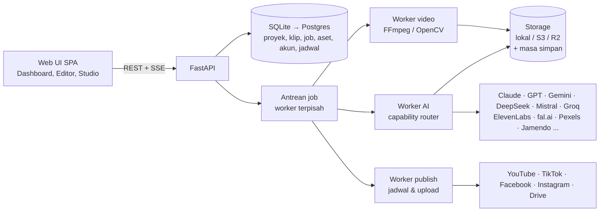
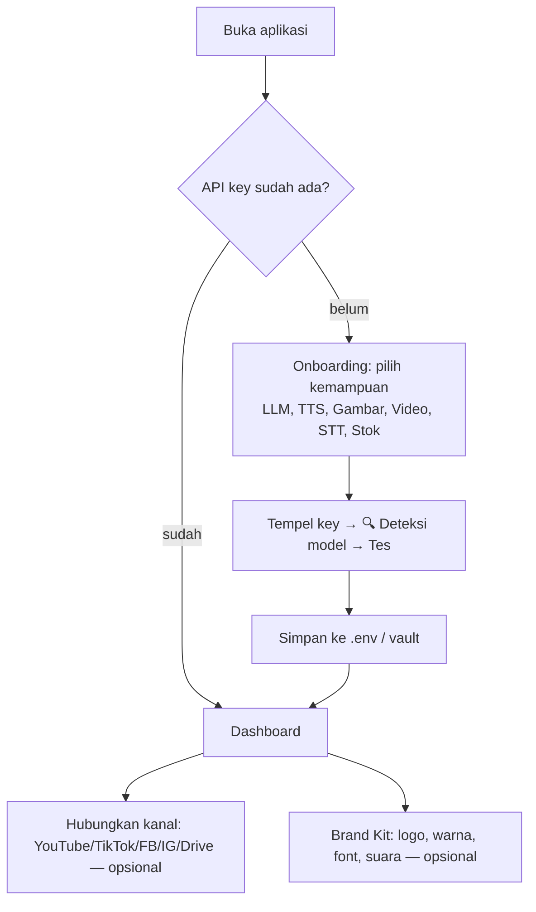
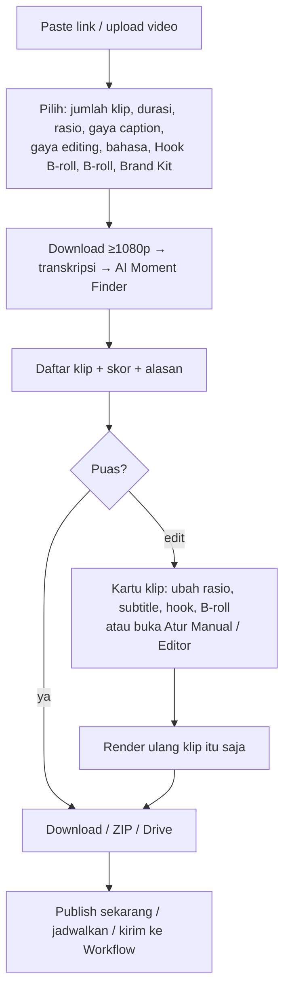
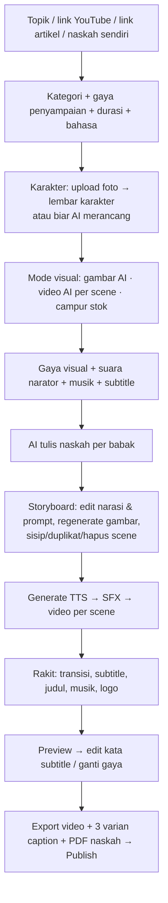
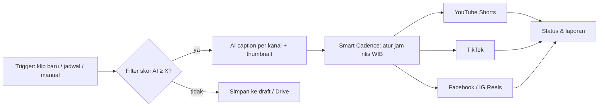

# 🗺️ PLAN UPGRADE v5 — Viral Auto Klip → AI Content Suite

> Disusun 2026-11-18 dari riset **halaman & bundle JavaScript publik** klipers.pro (tanpa login — tidak ada akses ke dashboard di balik login).
> Tujuan: **paritas fitur** (setara/lebih) dengan memanfaatkan banyak API key AI milikmu — **bukan** menyalin merek, desain UI, atau teks pemasaran mereka. Produkmu tetap punya nama & identitas sendiri.

---

## 0. Ringkasan cepat

| | Klipers (dari bundle publik) | Viral Auto Klip sekarang (v4) |
|---|---|---|
| Fokus | **Suite** konten: clipping + generator konten faceless + studio animasi + tools audio + distribusi otomatis | **Clipping** video panjang → short + publish package |
| Halaman/fitur | ±70 route (lihat §1) | 1 alur utama + CLI + Streamlit |
| AI | Gemini TTS, ElevenLabs (v3/v4, clone, SFX), Fish Audio, Veo (video), MiniMax, Whisper large-v3, Llama (Groq) | 10 provider LLM, ElevenLabs/Groq/lokal STT |
| Distribusi | Auto-upload YouTube/TikTok/Facebook + Google Drive + **workflow builder** (node graph) + jadwal | Paket publish + upload YouTube/TikTok dasar |
| Bisnis | Paket (Basic/Pro/Enterprise/Lifetime), kredit (mis. 2 kredit/menit), add-on storage, kupon, affiliate, pembayaran (Mayar/QRIS), aplikasi Android | Tidak ada (alat pribadi) |

**Kesimpulan:** untuk "1:1" yang realistis, Viral Auto Klip harus berubah dari *skrip pemroses video* menjadi **aplikasi dengan proyek, antrean job, penyimpanan, dan banyak modul**. Rencana di bawah dibagi 9 fase; Fase 0–2 memberi dampak terbesar untuk tujuanmu (memaksimalkan API key).

---

## 1. Peta fitur Klipers → status di Viral Auto Klip

Legenda: ✅ sudah ada · 🟡 sebagian · ❌ belum ada

### 1A. Clipping (inti)
| Fitur (route / nama di bundle) | Yang terlihat di bundle publik | Status VAK |
|---|---|---|
| **Quick Process** / `analisis-ai` | Paste link YouTube → AI pilih momen viral, hingga 25 klip | ✅ (AI Moment Finder, maks 20 klip) |
| Rasio output | 9:16, 1:1, 4:3, Original, **16:9 Crop / Pad / Blur / Zoom 25% / Zoom 50%** | 🟡 9:16, 16:9, Fit |
| Mode deteksi | Auto Detection, 👤 Face Detect, 🎙️ Podcast | ✅ (YuNet + pembicara aktif) |
| **Atur Manual** (`atur-manual`) | Set titik mulai/selesai di timeline, tambah teks, preview | ❌ |
| **Split-Cam** (`split-cam`) | Gameplay + facecam dalam satu layar, deteksi area wajah, atur proporsi | 🟡 (split screen 2 orang saja) |
| **Hook B-roll** | Pembuka bernarasi + kartu judul + latar AI/upload, pilih bahasa hook, 10 gaya (Majalah, Komik, Arsip, Podcast Cover…) | 🟡 (kartu hook teks saja, tanpa narasi/latar) |
| **B-roll** (`BrollPage`) | Otomatis tiap momen (Kolase/Footage), kategori latar (bola, religi, otomotif…), upload latar sendiri (pustaka maks 20), "Studio" merapikan potongan orang (segmentasi + kuas) | ❌ |
| **Overlay motion graphic** | Grafik/angka/perbandingan muncul saat kalimatnya diucapkan (±1 tiap 6 dtk, maks 12/klip) | ❌ |
| **Edit klip otomatis** | Jeda dipotong, zoom tiap kalimat, teks + SFX | ✅ (jump cut, zoom dinamis, SFX) |
| **Subtitle Presets** (`subtitle-presets`) | Banyak preset (Chat Bubble, dll.), stroke, highlight, words per subtitle, textCase, emoji, bahasa | 🟡 (8 style) |
| **Edit subtitle tanpa render ulang** (`SubtitleLivePage`) | Edit kata subtitle langsung | ❌ (subtitle di-burn) |
| **Terjemah subtitle** | ID / EN / Malaysia, fallback ke bahasa asli | ❌ |
| **Brand Kit** (`brand-kit`) | Logo di semua klip, ukuran 5–60%, posisi, sembunyi saat hook | 🟡 (watermark teks) |
| Virality Score di editor | Skor potensi viral klip terpilih | ✅ (skor + breakdown) |
| **Sports Highlight** (`sports-highlight`) | Analisis pertandingan dengan menonton video, narasi komentator TTS saat gol | ❌ |
| **Konten Tempel** (`konten-tempel`) | Tempel gambar/video/elemen di atas video | ❌ |
| Halaman klip (`clips`, `videos`) | Download ZIP semua, salin judul/deskripsi/transkrip ber-timestamp, upload Google Drive, jadwal upload, hapus massal, masa simpan per paket | 🟡 |

### 1B. Video Editor (`video-editor`)
| Fitur | Status |
|---|---|
| Timeline multi-track, sisipkan di playhead, drag & drop media | ❌ |
| Template teks: Basic Title, Lower Third, Bold Caption, Gaming Title, Quote, Judul Klip, Topic Pill, Glow Border | ❌ |
| Transisi: Fade Hitam/Putih, Wipe, Slide 4 arah, Smooth, Circle Buka/Tutup, Cover, Reveal | ❌ |
| Stiker GIF/emoji animasi | ❌ |
| Efek: Digital Glitch, Zoom Pulse, Film Grain, Lens Flare | 🟡 (color grade, zoom) |
| Cari musik (Jamendo) & SFX (Freesound), atau buat via Music Generator | ❌ |
| Font khusus (Archivo Black, Bebas Neue, Fredoka One, Instrument Serif, Noto Naskh Arabic, LPMQ untuk teks Arab) | ❌ |
| Auto Captions, Virality Score, export per platform | 🟡 |

### 1C. AI Content Creator (`ai-content-creator`) — **generator konten faceless**
Bukan clipping: dari topik → video jadi.
| Langkah / opsi | Status |
|---|---|
| Input: topik manual, **link YouTube** (AI baca transcript + metadata), atau naskah sendiri | ❌ |
| Kategori & preset topik (Sejarah, Religi/Islami, Sains & Tekno, Mental Health, Mitos vs Fakta, Keuangan, Fakta Unik, Luar Angkasa, Cerita Rakyat, True Crime, Review Film, Berita, Opini & Debat, Lagu Edukasi Anak…) | ❌ |
| Gaya penyampaian: Naratif & emosional, Step-by-step edukatif, Inspiratif, Fakta viral, Profesional, Menegangkan, Ceria, Kritis/kontroversial, Savage (dengan pagar SARA/body-shaming) | ❌ |
| Fokus Topik vs Fokus Tokoh; struktur babak (Hook → perkenalan → konflik → climax → resolusi → ending: plot twist, dll.) | ❌ |
| **Karakter konsisten**: foto pemeran → *lembar karakter*, pemeran pendukung, wajah sama di tiap adegan | ❌ |
| Mode visual: **semua gambar AI** · **tiap scene jadi klip video AI** (bayar per durasi) · **campur AI + video stock** (tiap scene ke-3 footage) · ambil gambar asli dari web | ❌ |
| Gaya visual: 3D render, 3D claymation, stop-motion, anime/manga, kartun ceria, komik (panel), found footage, dll. | ❌ |
| **Storyboard review**: preview semua gambar dulu, edit narasi & prompt gambar per scene, regenerate gambar, duplikat/sisipkan scene | ❌ |
| Narasi TTS, SFX per scene (ElevenLabs), musik latar (cari Jamendo), transisi percikan tinta, auto subtitle, judul menempel | ❌ |
| Output: video, 3 varian caption per platform (TikTok/IG), copy narasi, export PDF naskah, "Brand Voice" tersimpan | ❌ |

### 1D. Studio animasi
| Fitur | Status |
|---|---|
| **Story Studio** (`story-studio`): video bercerita bergambar; gaya: stickman, kartun flat, whiteboard doodle, kolase kertas, cat air, anime, komik noir, pixel art, animasi 3D, low-poly, diorama, sinematik, foto dokumenter, arsip sejarah, fantasi epik; efek gambar per adegan, kedalaman 3D (parallax), kartu info, 17 suasana tempat + 23 efek kata | ❌ |
| **Motion Studio / Motion Graphic** (`motion-studio`): explainer animasi dari ide/naskah/link berita; preset **Bedah 3D**, **Proses 3D**, **Geografi**, **Sinematik**; revisi AI; foto produk di adegan; render 3D di browser | ❌ |
| **Buat Cerita** (`buat-cerita`) | ❌ |

### 1E. Tools audio
| Fitur | Status |
|---|---|
| **Text to Speech**: suara Indonesia (pria/wanita), Gemini TTS (Kore, Puck, Aoede, Charon, Fenrir, Zephyr, Achernar, Leda…), ElevenLabs v3/v4, Fish Audio; banyak bahasa; segmen, riwayat, Advanced | 🟡 (TTS hanya untuk SFX internal — belum ada) ❌ |
| **Voice Clone**: rekaman 10 dtk–3 mnt, bersihkan suara latar, lintas bahasa, slot per paket | ❌ |
| **Music Generator**: prompt, lirik custom, Cover Song, Sing Over, generator sound/SFX | ❌ |

### 1F. Tools utilitas & riset
| Fitur | Status |
|---|---|
| **Transcript Generator**: dari YouTube, TXT/SRT/PDF, terjemahan | 🟡 (transkrip internal) |
| **Title Optimizer**: 4 judul (SEO / Viral / CTR / Balanced) + deskripsi 250–300 char + 15 tag | 🟡 (AI packaging 1 judul) |
| **Prompt Generator** (prompt gambar/video AI) | ❌ |
| **Thumbnail Download** (YouTube) | ❌ |
| **Seamless Loop** (loop 2–500×, target durasi) | ❌ |
| **Merge Video** (gabung klip + transisi, urutkan) | ❌ |
| **WA Story Optimizer** (kompres & potong untuk Status WhatsApp) | ❌ |
| **Viral Analytics**: skor viral, estimasi pendapatan, tren naik, waktu upload terbaik, persaingan | 🟡 (jadwal statis) |
| **Viral Suggestion** (pola konten viral per niche) | ❌ |
| **Data Analysis** multi-platform (YouTube, TikTok, X, Google Trends) | ❌ |

### 1G. Distribusi & otomasi (`integrations`)
| Fitur | Status |
|---|---|
| Hubungkan akun YouTube, TikTok, Facebook (+ Google Drive) | 🟡 (YouTube OAuth, TikTok cookies) |
| Jadwal upload, Smart Cadence, AI caption per kanal, status sinkron otomatis, thumbnail/sampul upload | ❌ |
| **Workflow builder** (node graph React Flow): trigger → filter skor AI → cabang logika → publish serentak/berjeda, Auto-Pilot, validasi sebelum eksekusi, jam WIB | ❌ |

### 1H. Platform & bisnis (hanya bila dijadikan SaaS)
Akun (email + Google OAuth, verifikasi email, lupa password), profil + kunci API pribadi (mis. ElevenLabs sendiri = gratis), paket & **kredit**, add-on storage, kupon, pembayaran (Mayar/QRIS) + riwayat transaksi, affiliate (komisi tunai/kredit), masa simpan file per paket, admin panel, API publik + docs, aplikasi desktop/Android, blog, changelog, tutorial, FAQ, halaman legal (privacy, terms, refund, DMCA, cookies, aksesibilitas), trust center, giveaway, analitik (Umami). — semua ❌.

---

## 2. Routing AI: memanfaatkan API key milikmu

| Kemampuan | Provider yang bisa dipakai (pilih/fallback) | Dipakai di |
|---|---|---|
| Teks/LLM (naskah, analisis, judul, caption) | Claude, GPT, Gemini, DeepSeek, Mistral, Groq, OpenRouter, Ollama, Custom | Semua modul (✅ sudah ada `core/ai_providers.py`) |
| **Vision / memahami video** | Gemini (video langsung), GPT & Claude (frame), Groq Llama vision | Sports Highlight, B-roll matching, Hook B-roll, deteksi momen visual |
| **Gambar** | OpenAI image, Gemini image, Flux/Seedream/dll. via fal.ai/Replicate/OpenRouter, Ideogram/Recraft | Content Creator, Story Studio, latar B-roll, thumbnail |
| **Video AI** (image→video) | Veo (Gemini API), Kling/Hailuo/Seedance/Wan via fal.ai/Replicate, Runway, Luma | Mode "tiap scene jadi video AI" |
| **TTS** | ElevenLabs, Gemini TTS, OpenAI TTS, Fish Audio, Azure | Narasi Content Creator, Hook B-roll, TTS page, komentator bola |
| **Voice clone** | ElevenLabs, Fish Audio | Voice Clone |
| **STT** | ElevenLabs Scribe, Groq Whisper, OpenAI, Whisper lokal | ✅ sudah ada |
| **Musik & SFX AI** | ElevenLabs Music & Sound Effects, (Suno/Udio via pihak ketiga — cek ToS) | Music Generator, SFX per scene |
| **Pustaka stok (gratis/API key)** | Pexels, Pixabay (video/gambar), Jamendo (musik CC), Freesound (SFX CC) | Mode campur stok, editor |
| Terjemahan | LLM mana pun / DeepL | Terjemah subtitle, multi-bahasa |

> ⚠️ Nama model berubah cepat — semua model dipilih lewat tombol **🔍 Deteksi model** (sudah ada) dan disimpan per kemampuan, bukan di-hardcode.

**Desain baru:** `core/ai_providers.py` diperluas menjadi **capability router**: `llm`, `vision`, `image`, `video`, `tts`, `clone`, `stt`, `music`, `sfx`, `stock`. Tiap kemampuan punya *provider utama + fallback* yang diatur di tab Pengaturan, plus pencatat **biaya per job** (token/detik/karakter) supaya kamu tahu API mana yang terpakai.

---

## 3. Arsitektur target

Perubahan wajib dari v4:
1. **Database + model data** (Project, Source, Clip, Job, Asset, Character, Voice, BrandKit, Channel, Schedule, Workflow, CostLog) — sekarang job hanya di memori dan hilang saat server mati (penyebab hasil terakhirmu kehilangan data).
2. **Antrean job tahan restart** (worker terpisah dari web server; job bisa dilanjutkan) + progres real-time (SSE).
3. **Storage & masa simpan** (auto-hapus, kuota, ZIP, Google Drive).
4. **Frontend SPA** (mis. React/Vite atau Svelte): satu file HTML tidak akan cukup untuk editor timeline & studio.
5. **Render teks/animasi** untuk editor & motion graphic: FFmpeg + ASS untuk dasar; animasi kompleks (Motion/Story Studio) butuh renderer berbasis browser (mis. Remotion/Three.js) atau Python (Pillow/Skia) frame-by-frame.

---

## 4. User flow

### 4.1 Setup pertama kali

### 4.2 Clipping (Quick Process)

### 4.3 AI Content Creator (faceless)

### 4.4 Distribusi otomatis (Workflow)

---

## 5. TO-DO per fase

Setiap item: **[ ] tugas — kriteria selesai**. Perkiraan kasar untuk 1 developer + AI assistant.

### Fase 0 — Fondasi (±1–2 minggu) — **WAJIB sebelum yang lain**
- [ ] SQLite + SQLAlchemy/SQLModel, migrasi (Alembic) — job/klip tidak hilang saat server restart
- [ ] Antrean job tahan restart (RQ/Arq/Dramatiq atau tabel job + worker) — job lanjut setelah restart; bisa dibatalkan
- [ ] Progres real-time (SSE) + log per job yang bisa dibuka di UI
- [ ] Storage manager: folder per proyek, masa simpan, kuota, pembersihan otomatis
- [ ] Capability router AI (`llm/vision/image/video/tts/clone/stt/music/sfx/stock`) + fallback + **CostLog** per job
- [ ] Vault API key (terenkripsi lokal) + Deteksi model per kemampuan + tes koneksi
- [ ] Frontend SPA (React/Vite atau Svelte) dengan routing; UI v4 dimigrasi
- [ ] i18n ID/EN
- [ ] Mode **lokal satu pengguna** (tanpa login) sebagai default; kerangka auth disiapkan

### Fase 1 — Paritas clipping (±2–3 minggu)
- [ ] Rasio lengkap: 1:1, 4:3, Original, 16:9 Crop/Pad/Blur/Zoom 25%/Zoom 50%
- [ ] Kartu klip: ubah rasio/subtitle/hook/B-roll per klip + render ulang satu klip
- [ ] **Atur Manual**: timeline trim mulai/selesai + teks + preview
- [ ] **Split-Cam**: deteksi area facecam & gameplay, layout atas/bawah & proporsi
- [ ] **Subtitle preset** banyak (chat bubble, highlight box, dll.) + parameter (stroke, highlight, words/subtitle, textCase, emoji, bahasa)
- [ ] **Edit subtitle tanpa render ulang** (simpan ASS terpisah, burn hanya saat export) + **terjemah subtitle** ID/EN/MY
- [ ] **Hook B-roll**: kartu pembuka bernarasi (TTS) + latar AI/upload + 10 gaya + pilihan bahasa hook
- [ ] **B-roll otomatis**: Kolase/Footage (Pexels/Pixabay/gambar AI) di momen kunci; pustaka latar pribadi
- [ ] **Overlay motion graphic**: angka/grafik/perbandingan saat diucapkan (maks 12/klip, tidak menutup subtitle/watermark)
- [ ] **Brand Kit**: logo (ukuran 5–60%, posisi), warna, font, suara; sembunyi saat hook
- [ ] Halaman klip: ZIP semua, salin judul/deskripsi/transkrip ber-timestamp, hapus massal, Google Drive
- [ ] Analisis AI hingga 25 klip
- [ ] **Sports Highlight**: vision AI cari gol/momen, narasi komentator TTS

### Fase 2 — Video Editor (±3–4 minggu)
- [ ] Timeline multi-track (video, teks, stiker, audio, SFX), playhead, drag & drop, undo/redo
- [ ] Template teks (judul, lower third, quote, gaming title, topic pill, glow border)
- [ ] 15+ transisi (fade, wipe, slide, smooth, circle, cover, reveal)
- [ ] Stiker GIF/emoji animasi
- [ ] Efek: glitch, zoom pulse, film grain, lens flare
- [ ] Cari musik (Jamendo) & SFX (Freesound) + dari Music Generator
- [ ] Font (Bebas Neue, Archivo Black, Fredoka One, Instrument Serif, Noto Naskh Arabic/LPMQ) dengan lisensi jelas
- [ ] Export per platform + Virality Score

### Fase 3 — AI Content Creator (±3–4 minggu)
- [ ] Input topik / link YouTube / link artikel / naskah sendiri
- [ ] Katalog kategori & preset topik + gaya penyampaian (dengan pagar keamanan konten)
- [ ] Struktur babak + gaya ending
- [ ] Karakter konsisten (foto → lembar karakter → referensi di tiap gambar)
- [ ] 3 mode visual (gambar AI · video AI per scene · campur stok) + gaya visual
- [ ] Storyboard editor (narasi, prompt, regenerate, sisip/duplikat/hapus) — kredit/biaya hanya untuk yang jadi
- [ ] TTS narasi + SFX per scene + musik + transisi + subtitle + judul
- [ ] Output + 3 varian caption per platform + export PDF + Brand Voice
- [ ] Penanda metadata "dibuat AI" + moderasi konten gambar/video AI + tombol laporkan

### Fase 4 — Tools audio (±1–2 minggu)
- [ ] Halaman TTS: semua provider, pilih suara & bahasa, segmen, riwayat, unduh
- [ ] Voice Clone (ElevenLabs/Fish): rekaman 10 dtk–3 mnt, pembersih noise, daftar suara
- [ ] Music Generator: prompt, lirik, sound/SFX generator

### Fase 5 — Tools utilitas & riset (±2 minggu)
- [ ] Transcript Generator (TXT/SRT/PDF + terjemahan)
- [ ] Title Optimizer (4 varian + deskripsi + 15 tag)
- [ ] Prompt Generator, Thumbnail Download, Seamless Loop, Merge Video, WA Story Optimizer, Konten Tempel
- [ ] Viral Analytics & Data Analysis (YouTube Data API, Google Trends; TikTok/X sesuai ketersediaan API resmi)
- [ ] Viral Suggestion per niche

### Fase 6 — Distribusi & otomasi (±2–3 minggu)
- [ ] Koneksi resmi: YouTube Data API, TikTok Content Posting API, Facebook/Instagram Graph API, Google Drive
- [ ] Penjadwal (WIB), Smart Cadence, AI caption per kanal, thumbnail/sampul, status sinkron
- [ ] Workflow builder (node graph): trigger → filter skor → cabang → publish; validasi sebelum eksekusi
- [ ] Riwayat & laporan upload

### Fase 7 — Studio animasi (±4–8 minggu, paling berat — opsional)
- [ ] Story Studio: gaya gambar, parallax 3D, kartu info, suasana & efek kata
- [ ] Motion Studio: explainer dari ide/naskah/berita; preset 3D (butuh renderer 3D)

### Fase 8 — Platform/bisnis (hanya bila dijual sebagai SaaS)
- [ ] Akun (email + Google), verifikasi, reset password
- [ ] Paket, kredit (rumus per menit/per aset), add-on storage, kupon
- [ ] Gateway pembayaran (Midtrans/Xendit/Mayar), invoice, riwayat
- [ ] Affiliate, admin panel, API publik + docs, rate limit
- [ ] Halaman legal (privacy, terms, refund, DMCA), changelog, tutorial, FAQ
- [ ] Aplikasi desktop (Tauri/Electron) / Android (PWA dulu)

---

## 6. Kebutuhan yang tidak boleh terlewat

**API key / akun**
- LLM (sudah): Claude/GPT/Gemini/DeepSeek/Mistral/Groq
- Gambar & video AI: OpenAI/Gemini + **fal.ai atau Replicate** (akses Kling/Hailuo/Seedance/Flux dll.)
- Audio: **ElevenLabs** (TTS, clone, SFX, musik), opsional Fish Audio, Gemini TTS
- Stok gratis: **Pexels**, **Pixabay**, **Jamendo** (client ID), **Freesound** (API key)
- Distribusi: Google Cloud (YouTube Data API + Drive OAuth), **TikTok for Developers** (Content Posting API — perlu audit app), **Meta for Developers** (Graph API — IG harus akun bisnis)

**Teknis**
- FFmpeg ≥7, font berlisensi (termasuk Arab untuk konten religi), GPU opsional (NVENC/Whisper)
- Storage besar (video sumber + render); rencana masa simpan
- Worker terpisah agar web tetap responsif; batas paralel render

**Kuota & batas platform**
- YouTube Data API: kuota harian default ±10.000 unit (1 upload ≈ 1.600 unit → ±6 upload/hari/proyek GCP) — ajukan kenaikan bila perlu
- TikTok: app belum diaudit hanya bisa posting privat
- Biaya API video AI per detik bisa besar → tampilkan estimasi biaya sebelum render

**Legal & etika**
- Hak cipta video sumber (izin kreator/fair use), lisensi musik (Jamendo CC, Freesound per-file), font
- Label konten AI (metadata C2PA/IPTC "dibuat AI"), moderasi gambar/video AI
- Data pengguna & API key dienkripsi; jangan simpan key di browser
- Jangan memakai merek, logo, UI, atau teks klipers.pro

---

## 7. Keputusan yang perlu kamu ambil

1. **Pribadi atau SaaS?** Pribadi → lewati Fase 8 (hemat ±1–2 bulan). SaaS → butuh hosting, pembayaran, legal.
2. **Frontend**: React/Vite (ekosistem editor/timeline paling banyak) atau Svelte (lebih ringan)?
3. **Hosting**: tetap di laptop (Windows) atau VPS/GPU cloud?
4. **Prioritas setelah Fase 0**: rekomendasiku **Fase 1 → 3 → 6** (clipping lengkap, generator konten faceless, auto-publish) karena paling memanfaatkan API key-mu.
5. Nama & identitas produk sendiri (logo, warna, gaya bahasa).

---

## 8. Yang belum terlihat (perlu login/demo)

Riset ini hanya dari halaman & kode publik. Yang **belum** bisa diverifikasi: tata letak dashboard sebenarnya, angka harga/kredit tiap paket, detail form tiap tool, kualitas hasil render mereka. Untuk melengkapi: kirim **screenshot / rekaman layar** tiap halaman, atau hubungkan MCP browser (mis. camofox) di sesi berikutnya — lalu bagian §1 diperbarui.

---

## 9. Sumber riset
- Route & nama halaman: bundle `assets/index.*.js` (publik) — ±70 route.
- Label UI, opsi, pesan: 85 chunk JS publik (`AIContentCreatorPage`, `VideoEditorPage`, `StoryStudioPage`, `IntegrationsPage`, `ChangelogPage`, dll.).
- Riwayat fitur: teks changelog di bundle publik.
